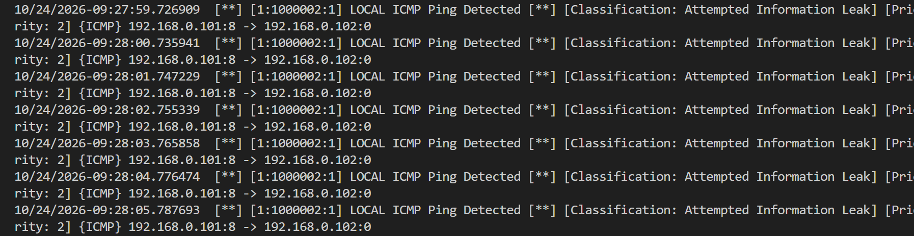
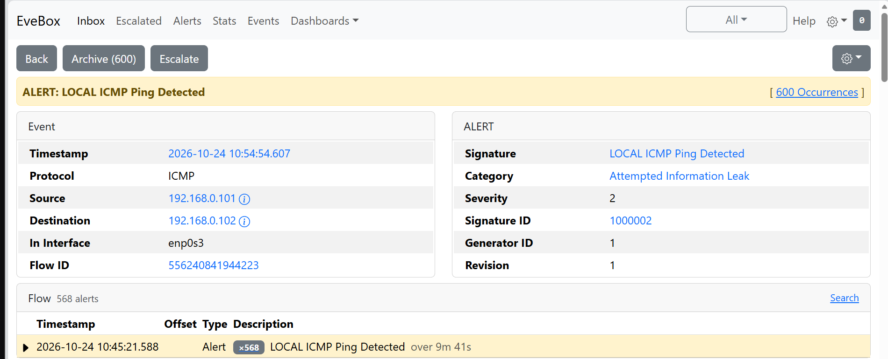
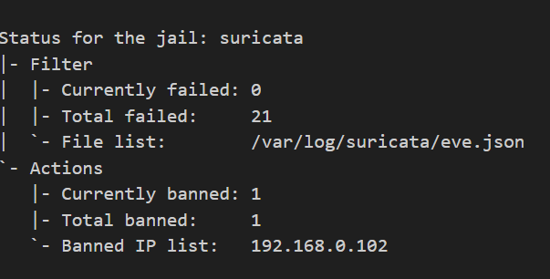

#  Network Intrusion Detection & Prevention System (NIDS/NIPS)
### CodeAlpha Cybersecurity Internship - Task 2

##  Project Overview
This project is a fully functional Network Intrusion Detection and Prevention System (NIDS/NIPS) deployed in a virtualized lab environment. It demonstrates a complete Security Operations Center (SOC) pipeline: capturing network traffic, detecting malicious activity via custom rules, automatically blocking the attacker, and visualizing the alerts on a real-time web dashboard.

The goal of this project was to build a system that doesn't just monitor network traffic for attacks (IDS), but actively defends against them (IPS) and provides visual telemetry.

##  Task Objectives Met
1. **Set up a NIDS:** Deployed Suricata on an Ubuntu Server VM using VirtualBox with a Bridged network adapter for real traffic visibility.
2. **Configure Rules & Alerts:** Created custom rules to detect ICMP reconnaissance and ping floods.
3. **Continuous Monitoring:** Configured Suricata to run as a background service and output structured JSON logs (`eve.json`).
4. **Response Mechanism:** Integrated Fail2ban to dynamically read Suricata logs and ban offending IPs using `iptables`.
5. **Visualization:** Deployed EveBox, a lightweight web-based SIEM dashboard, to visualize attacks in real-time.

##  Architecture & Environment
- **Hypervisor:** VirtualBox (Bridged Adapter)
- **Operating System:** Ubuntu Server 24.04 LTS
- **Target Network:** `192.168.0.102/24`
- **Tech Stack Used:** 
  - **Suricata 8.0.3** (Intrusion Detection Engine)
  - **Fail2ban** (Automated Intrusion Prevention / Response)
  - **EveBox** (Web Dashboard / Visualization)
  - **SQLite** (EveBox Datastore)

---

##   Implementation Details & Configuration Files

### 1. Suricata Configuration
Suricata was configured to monitor the `enp0s3` interface and define the local home network.

**File: `/etc/suricata/suricata.yaml` (Key Sections)**
```yaml
vars:
  address-groups:
    HOME_NET: "[192.168.0.0/24]"

af-packet:
  - interface: enp0s3
```

### 2. Custom Detection Rule
A custom rule was written to detect ICMP (Ping) traffic, which attackers use for network reconnaissance and DoS attacks.

**File: `/etc/suricata/rules/local.rules`**
```suricata
alert icmp any any -> any any (msg:"LOCAL ICMP Ping Detected"; itype:8; classtype:attempted-recon; sid:1000002; rev:1;)
```

### 3. Automated Response (Fail2ban)
Fail2ban was configured to parse Suricata's JSON log (`eve.json`). If an IP triggers 3 alerts, it is banned for 10 minutes via `iptables`. A whitelist (`ignoreip`) was added to prevent self-lockout.

**File: `/etc/fail2ban/filter.d/suricata.conf`**
```ini
[Definition]
failregex = ^.*"event_type":"alert".*"src_ip":"<HOST>".*$
ignoreregex =
```

**File: `/etc/fail2ban/jail.local`**
```ini
[suricata]
enabled = true
filter = suricata
logpath = /var/log/suricata/eve.json
maxretry = 3
bantime = 600
ignoreip = 127.0.0.1/8 192.168.0.0/24
action = iptables-allports[name=suricata]
```

### 4. Visualization (EveBox)
EveBox was deployed as a lightweight web dashboard on port `5636` using a SQLite backend to accommodate the VM's 2GB RAM limit.

**File: `/etc/systemd/system/evebox.service`**
```ini
[Unit]
Description=EveBox Suricata Dashboard
After=network.target suricata.service

[Service]
Type=simple
User=root
ExecStart=/usr/local/bin/evebox server --host 0.0.0.0 --no-tls --datastore sqlite --data-directory /var/lib/evebox /var/log/suricata/eve.json
Restart=always
RestartSec=5

[Install]
WantedBy=multi-user.target
```

---

##  Proof of Concept (Screenshots)
### 1. Terminal Alerts Firing
*Suricata successfully detecting ICMP traffic and logging it to `fast.log`.*


### 2. EveBox Web Dashboard
*The EveBox dashboard provides real-time visualization of the alerts.*


### 3. Fail2ban Automated Mitigation
*Fail2ban automatically banned the attacking IP address after multiple failed attempts.*

```text
Status for the jail: suricata
|- Filter
|  |- Currently failed: 0
|  |- Total failed:     21
|  `- File list:        /var/log/suricata/eve.json
`- Actions
   |- Currently banned: 1
   |- Total banned:     1
   `- Banned IP list:   192.168.0.102
```

---

## Challenges Overcome & Troubleshooting
1. **Fail2ban Self-Lockout:** During testing, Fail2ban successfully blocked my host machine, severing the SSH connection to the VM. I resolved this by accessing the VM's console via VirtualBox, flushing `iptables`, and implementing a `/16` subnet whitelist in the `ignoreip` directive to prevent future lockouts.
2. **Log Truncation & Inodes:** EveBox uses file bookmarks. Truncating `eve.json` to clear logs caused an "inode mismatch" error, requiring a restart of the EveBox service to refresh the file descriptor.
3. **Network Bridging:** Successfully transitioned the VM from NAT to a Bridged Adapter so it could receive traffic from the physical host machine, which is required for a realistic IDS test.

##   Conclusion
This project successfully demonstrates the deployment of a robust, automated intrusion detection and prevention pipeline. It highlights practical Linux administration, firewall management (`iptables`), log analysis (`eve.json`), and security tool integration.

---
**Author:** Akalonu Emmanuella Nneka
**Internship:** CodeAlpha Cybersecurity Internship


